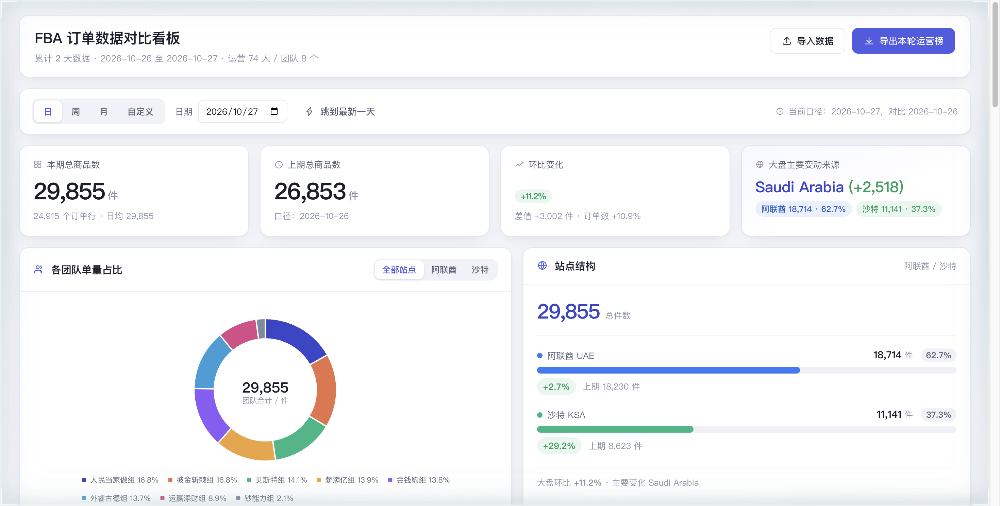
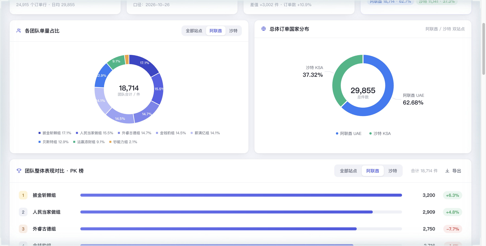
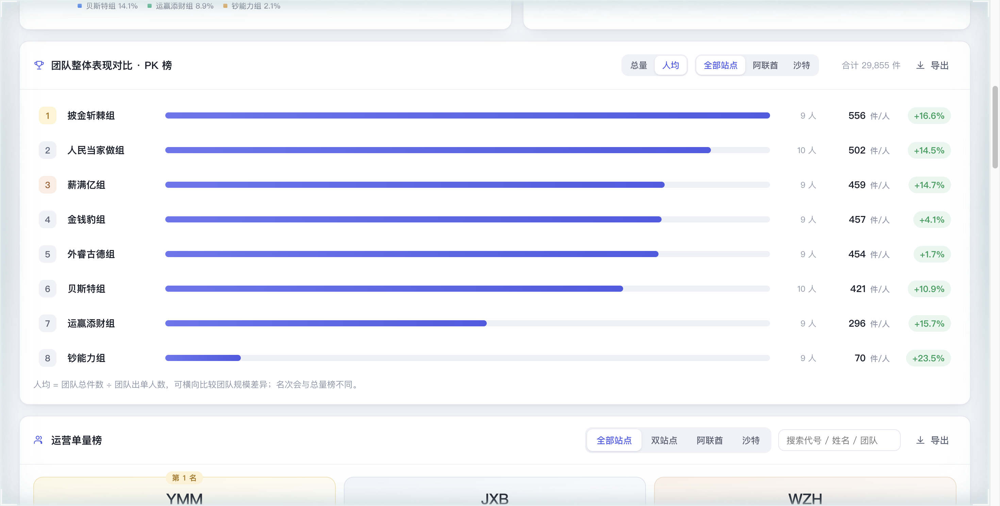
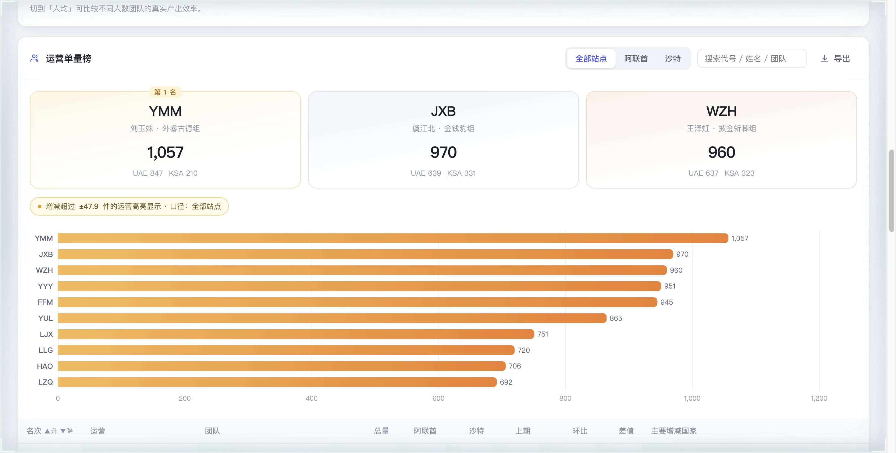
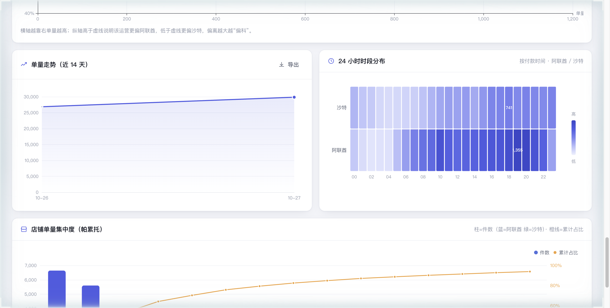
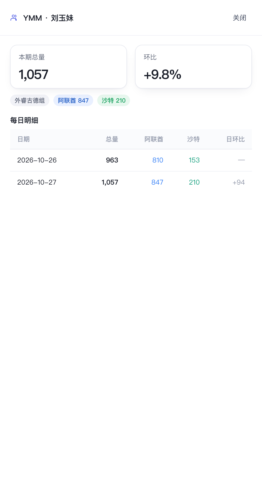
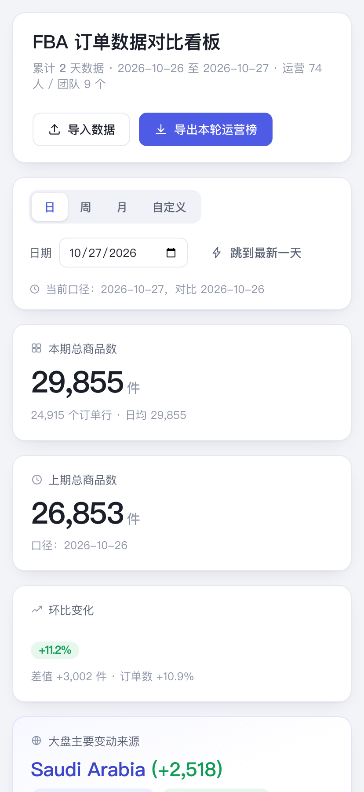
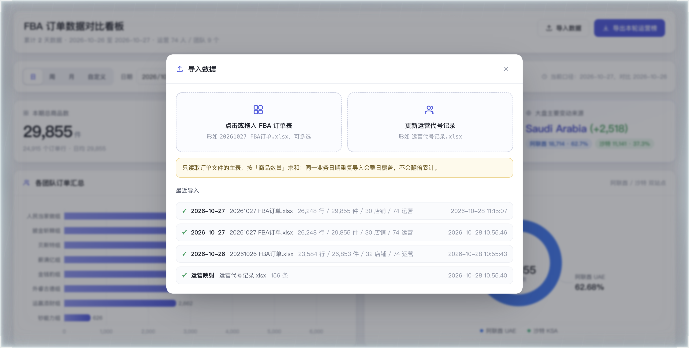
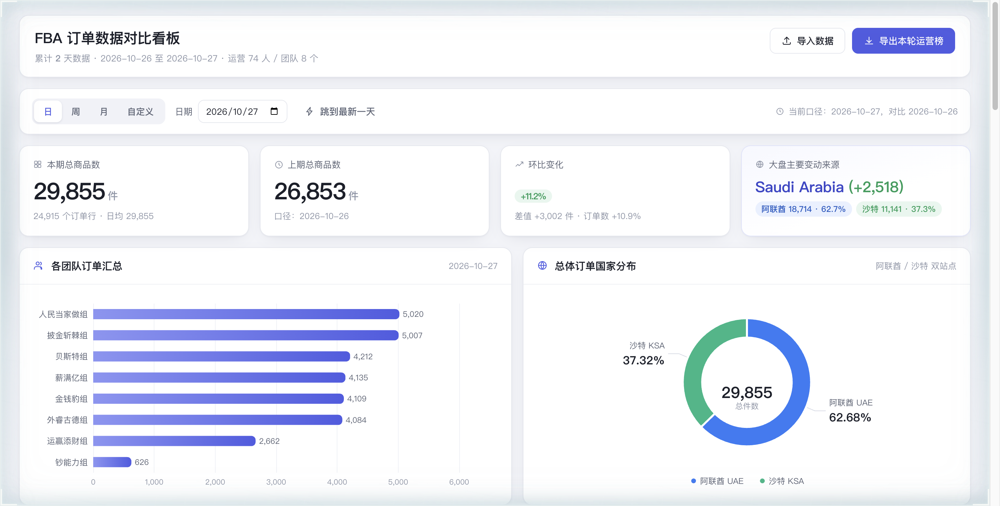

# FBA 订单数据对比看板

局域网共享的 FBA 订单对比面板：每天上传一次订单 Excel，自动按日累计，日 / 周 / 月 / 自定义区间对比，
团队 PK（总量/人均）、运营 Top10（全部/阿联酋/沙特）、24 小时时段热力、运营明细、CSV 导出。

```text
http://<本机局域网IP>:8770
```



## 这版做了什么

| 能力 | 说明 |
|---|---|
| 导入 | 右上角按钮打开**居中弹窗**（窄屏自动变为底部抽屉），上传 `2026xxxx FBA订单.xlsx`（可多选）+ `运营代号记录.xlsx`，支持拖拽 |
| 容错 | 接口异常时页面显示「重新加载」卡片，不会空白；同一天重复导入在日志里只显示最新一条 |
| 口径 | **只读订单文件主表**，按「商品数量」求和，与旧看板逐项一致（10.26=26853，10.27=29855，+11.2%） |
| 幂等 | 同一天重复上传会整日覆盖，不会翻倍累计 |
| 时间维度 | 日 / 周 / 月 / 自定义区间，自动对齐「上一周期」做环比 |
| 团队 | **团队单量占比圆环**（中心为团队合计，图例带占比，8 色相区分）+ 团队 PK 榜（可选**总量 / 人均**），两者共用「全部站点 / 阿联酋 / 沙特」口径切换；CSV 导出 |
| 时段 | **24 小时 × 国家热力图**：2026-10-27 峰值 20 点、谷值 04 点，两站点错峰明显 |
| 站点结构 | 国家维度改为**占比条 + 环比**，比双色环形图信息密度更高 |
| 运营 | 全部站点 / 阿联酋 / 沙特 三种口径的 Top10 领奖台 + 完整榜单，名次变化用 ▲升 ▼降 —持平 标注 |
| 异常高亮 | 增减绝对值超过全体均值 ±X 件的运营高亮（阈值按当期动态计算） |
| 明细 | 点任意运营开侧边抽屉，看逐日总量与双站拆分 |
| 分布 | 国家环形图（含总量）、店铺 Top10（按国家着色）、近 14 天走势 |
| 导出 | 运营榜 / 团队榜 / 每日走势 / 订单明细 CSV（带 BOM，Excel 直接打开不乱码） |
| 访问 | `0.0.0.0:8770`，局域网免登录；launchd 开机自启 + 崩溃自拉起 |

## 截图

| 总览（团队占比环 + 站点结构条） | 团队口径切到阿联酋 |
|---|---|
|  |  |

| 团队 PK 榜切到「人均」（名次翻转） | 运营榜名次变化（▲升 ▼降 —持平） |
|---|---|
|  |  |

| 24 小时时段热力 | 单人明细抽屉 |
|---|---|
|  |  |

| 手机端 | 导入弹窗 |
|---|---|
|  |  |

加载失败兜底（不会白屏）：



## 安装

```bash
cd /Users/wenwendemac/project/home-server/tool/shu_ke/fba_dashboard
./install.sh
```

脚本会：用 **uv** 建 `.venv` → `uv sync` 装依赖 → 写 `~/Library/LaunchAgents/com.wenwendemac.fba-dashboard.plist`
→ 立刻启动 → 打印局域网地址。

卸载（保留数据）：

```bash
./install.sh --uninstall
```

> 注意：`uv` 默认缓存目录 `~/.cache/uv` 在本机被沙箱限制，脚本里已把 `UV_CACHE_DIR` 指向工作区下的 `.uvcache`。

## 开发

```bash
./run.sh              # 前台热重载，http://127.0.0.1:8770
.venv/bin/python -m uvicorn app.main:app --port 8771   # 换端口
```

## 目录

```
fba_dashboard/
├── app/
│   ├── main.py        # FastAPI 路由：上传 / 统计 / 导出 / 静态页
│   ├── ingest.py      # Excel 解析与入库（主表识别、日期识别、幂等覆盖）
│   ├── analytics.py   # 聚合：总量、团队、运营榜、走势、明细
│   └── db.py          # SQLite 建表与连接
├── static/
│   ├── index.html     # Vue 模板（无构建）
│   ├── js/app.js      # 前端逻辑 + ECharts 配置
│   ├── css/app.css
│   └── vendor/        # 本地 vue.global.prod.js / echarts.min.js（内网不能走 CDN）
├── data/fba.db        # SQLite（自动创建，已 gitignore）
└── install.sh / run.sh
```

## 数据表

- `orders`：一行一个订单行（biz_date, order_id, country(UAE/KSA), shop, operator, qty, paid_at …）
- `operators`：运营代号 → 姓名 / 团队 / 主管
- `import_batches`：导入日志（页面上可见）
- `meta`：杂项键值

## 口径说明（重要）

源文件里 `HWC`、`HWC-W18SF-UAE09`、`SFHB` 三个 sheet 是主表的**子集重复行**。
本服务按你确认的口径**只取主表**，因此与浏览器端旧看板的数字完全一致。

如果以后想改成"跨表全量去重"，只需在 `app/ingest.py` 的 `_pick_main_sheet()` 里
把候选表全部返回并在入库前按 `(订单编号, 店铺名, 平台SKU)` 去重即可。

## 关于图表取舍

数据里有两个维度我验证过但**没有做图**，原因是做了也没有信息量：

- **SKU 维度**：单日 1.87 万个 SKU，Top1 仅占 0.13%，Top200 合计才 8.4%，画出来是一条平线。除非后续能补上品类映射表。
- **客单价**：团队间 1.114–1.154，差 3.6%，折线会完全重合。
- **店铺帕累托**：做过一版，但店铺 Top10 已在运营明细与导出里覆盖，单独占一张卡性价比不高，已移除。
- **运营人效散点**：做过一版（单量 × 站点偏好），实际使用中信息密度不如榜单直观，已移除。

另外订单状态只有 Shipped / Pending 两类，单个饼图即可，暂不单独占版面。

## 接口

| 方法 | 路径 | 说明 |
|---|---|---|
| GET | `/api/meta` | 可选日期、月份、团队、导入日志 |
| GET | `/api/summary?mode=day&day=2026-10-27` | 总览（KPI / 团队 / 国家 / 走势 / 店铺） |
| GET | `/api/operators?mode=day&day=…&scope=all` | 运营榜，`scope` = `all` / `both` / `uae` / `ksa` |
| GET | `/api/operators/{code}/daily` | 单人逐日明细 |
| GET | `/api/export.csv?kind=operators&mode=day&day=…` | CSV 导出，`kind` = `operators` / `teams` / `daily` / `orders` |
| POST | `/api/upload/orders` | 上传订单 xlsx |
| POST | `/api/upload/operators` | 上传运营代号记录 |
| GET | `/healthz` | 健康检查 |
| GET | `/api/docs` | 自动生成的接口文档 |
